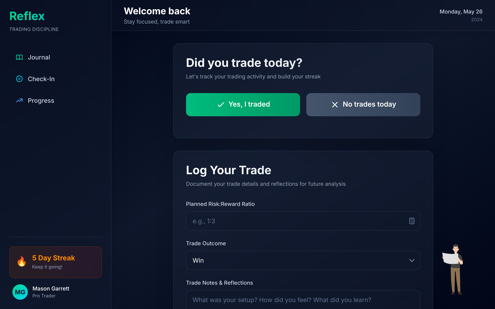
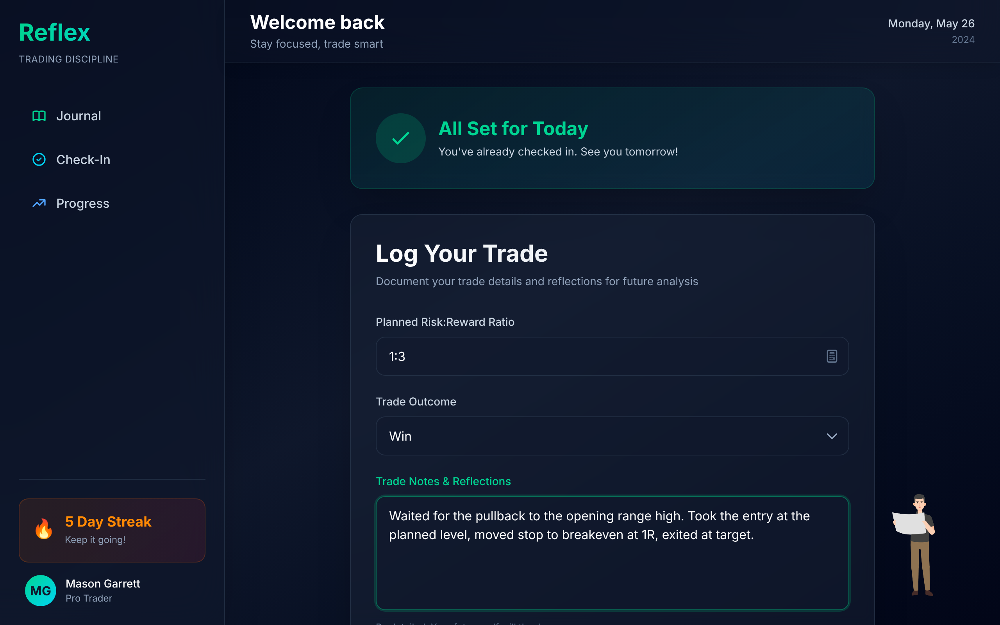
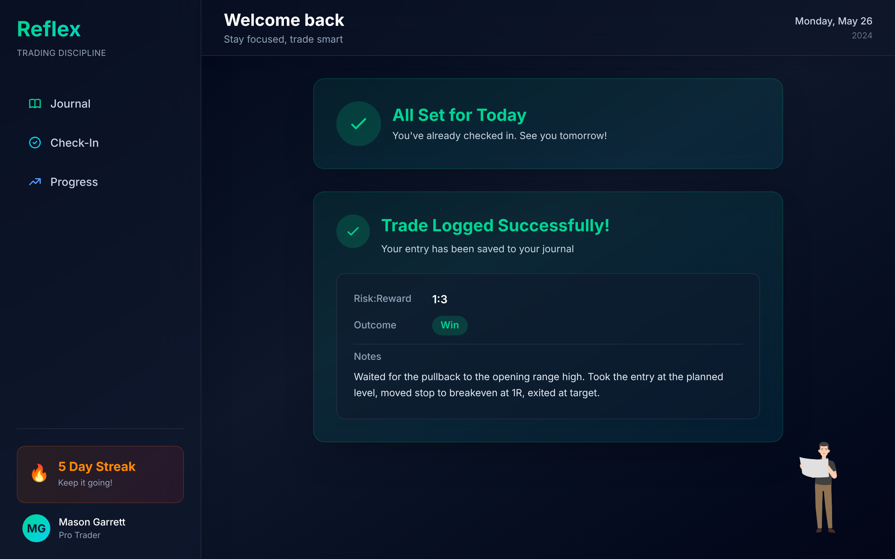

# Reflex – A Discipline Assistant for Prop Firm Traders

Reflex is a desktop app idea for funded traders: a local-first journal with daily check-ins, gamification, and a mascot that reacts to how you trade. It is built with Electron and React.

**Status: early prototype.** The UI shell, daily check-in, trade journal form, and an animated mascot run today. Entries live in in-memory state only and are lost on reload. Persistence, AI feedback, XP/badges, rule monitoring, and the resume export are planned and not built yet.

---

## Project Purpose

Traders in prop firm environments (Apex, Topstep, MyFundedFutures, etc.) often fail not because of poor strategy, but because of broken discipline. Reflex is meant to help by:

- Encouraging good habits and no-trade days
- Logging every trade with purpose, structure, and review
- Giving feedback through a mascot assistant
- Helping traders stick to their rules

---

## Current prototype

What the code does today:

- **App layout** – sidebar, header, and main content area (React + Tailwind). Sidebar links, the streak card, the user card, and the header date are static placeholders.
- **Daily check-in** – "Did you trade today?" with Yes/No. Records the answer in a Zustand store and switches to a "checked in" state for the session.
- **Trade journal form** – planned R:R, outcome (win/loss/breakeven), and notes, with basic validation. Submitting adds the entry to a Zustand store and shows a summary.
- **Mascot** – a Lottie animation pinned to the corner of the window. Several animations are bundled and wired to a mascot store, but nothing changes its state yet, so only the idle animation plays.
- **Electron shell** – a minimal main process that opens a window and loads the Vite dev server.

There is no database yet: `src/db/database.tsx` and `src/overlay/Mascot.tsx` are empty stubs, and check-ins and journal entries are only logged to the console and kept in memory.

## Planned

- SQLite persistence for journal entries, check-ins, and progress
- GPT-based feedback on trade quality and behavior patterns
- Streaks, XP, and badges driven by real data
- Rule system with live monitoring (max trades, trading hours, etc.)
- Transparent mascot overlay window that reacts to rule breaks
- Screenshot attachments on journal entries
- Exportable "Discipline Resume" PDF based on behavior, not PnL

---

## Tech Stack

- Electron – desktop shell
- React + Vite – UI and dev server
- Tailwind CSS v4 – styling
- Zustand – state management
- lottie-react – mascot animations
- SQLite – planned, not implemented
- OpenAI API – planned, not implemented

---

## Running Locally

Requires Node.js 18 or newer.

```bash
git clone https://github.com/garrettm19/reflex-trading-journal.git
cd reflex-trading-journal
npm install
```

| Command | What it does |
|---------|--------------|
| `npm run dev` | Starts the Vite dev server for the renderer at http://localhost:5173. Open it in a browser. |
| `npm start` | Starts the Vite dev server and, once it is up, opens the Electron window pointed at it. |
| `npm run build` | Builds the renderer to `dist/renderer`. There is no packaged Electron build yet. |

---

## Screenshots (prototype)

Captured from the renderer running in a browser via `npm run dev`.

| Main view | Journal form | Entry saved |
|-----------|--------------|-------------|
|  |  |  |

---

## File Structure

- `src/main/` – Electron main process
- `src/renderer/` – React UI, components, and Zustand stores
- `src/overlay/` – mascot overlay window (stub)
- `src/db/` – database layer (stub)
- `scripts/` – Electron start script
- `docs/` – SDLC and planning documents
- `demo/` – screenshots

---

## Documentation

Planning documents for each phase are in [`docs/`](docs/_index.md). They describe the intended design, which is further along than the code.

- [01 – Problem Discovery](docs/01_discovery_and_problem.md)
- [02 – Feature Requirements](docs/02_feature_requirements.md)
- [03 – System Architecture](docs/03_system_architecture.md)
- [04 – Data Model](docs/04_data_model.md)
- [05 – Wireframes](docs/05_ui_wireframes.md)
- [06 – AI Design](docs/06_ai_design.md)
- [07 – Build Plan](docs/07_build_plan.md)
- [08 – Demo and Reflection](docs/08_demo_and_reflection.md)
- [09 – User Stories](docs/09_user_stories.md)
- [10 – Metrics & Success Plan](docs/10_metrics_and_success.md)
- [11 – User Persona & Flow](docs/11_user_persona_and_flow.md)

---

## Next Steps

- [x] Scaffold Electron + React
- [x] Check-in and journal form UI with local state
- [x] Mascot idle animation
- [ ] Implement SQLite journaling backend
- [ ] Trigger mascot reactions from app events
- [ ] Separate transparent overlay window for the mascot
- [ ] Add XP and badge logic
- [ ] Connect GPT feedback to journal entries
- [ ] Build resume export
- [ ] Record a demo walkthrough

---

## License

MIT — see [LICENSE](LICENSE).

---

## Author

Built by Mason Garrett
GitHub: [garrettm19](https://github.com/garrettm19)
